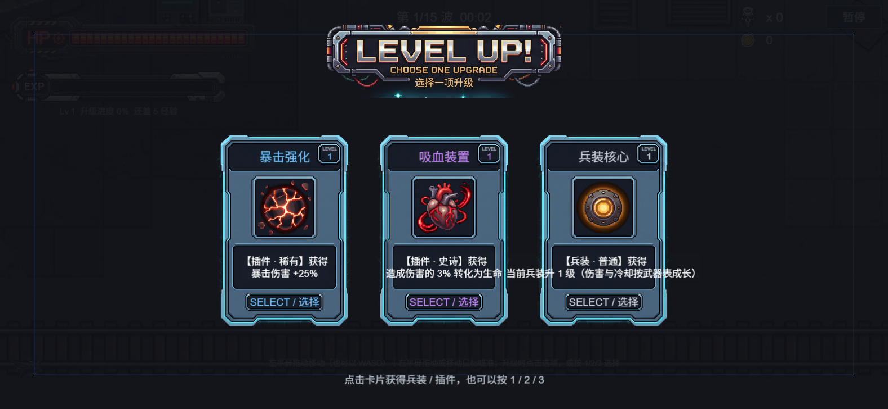
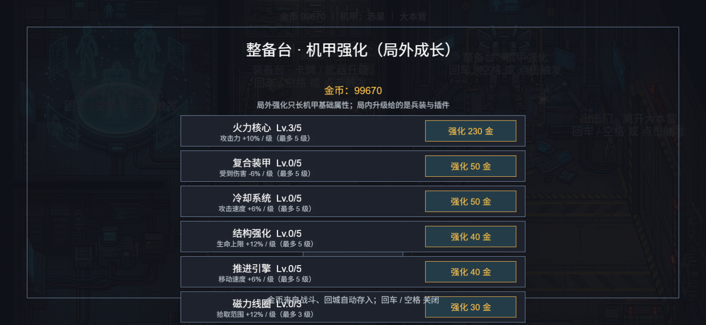
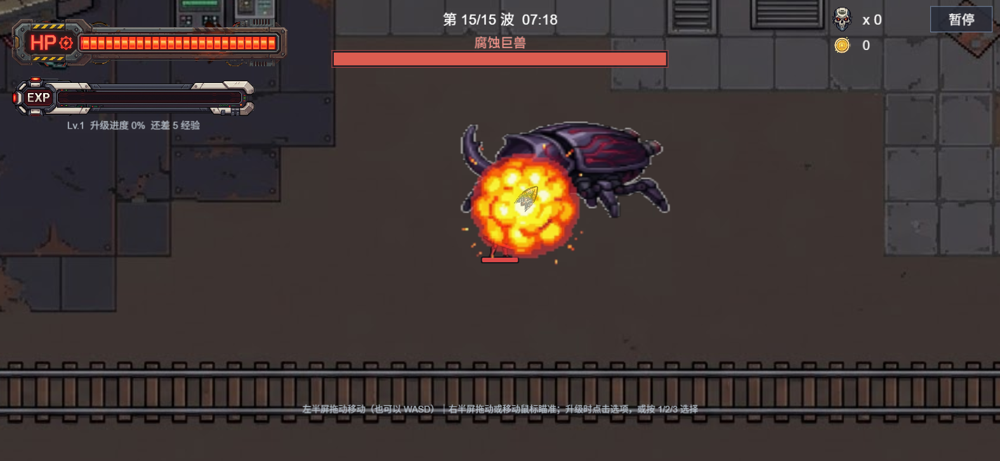
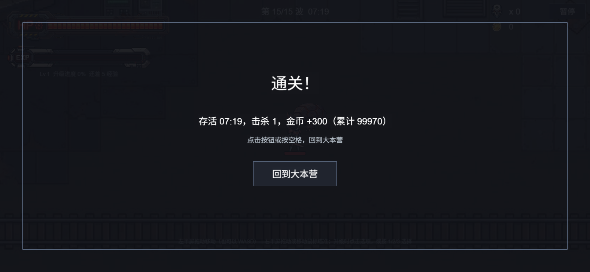

## v0.8.0 · 卡牌系统重做（兵装 / 插件）+ 局外机甲强化

这一版把「局内升级」和「局外成长」彻底分开了，改法参考吸血鬼幸存者：**局内只给武器形态和特殊机制，机甲的基础属性全部挪到局外**。

### 局内升级：18 张卡，全是新东西

**兵装（5 张）—— 只管武器形态**

- 兵装核心：武器升一阶，吃武器表里配好的伤害 / 冷却 / 射程（共四阶形态）
- 广域剑风：挥砍扇形角度 +20°
- 超频模块：当前兵装载填速度 +12%
- 穿透弹头：光束额外多穿 1 个目标
- 高爆装药：榴弹爆炸范围 +15%

**插件（13 张）—— 特殊数值与机制**

- 霜冻模块：命中让敌人减速 25%，敌人会染上一层淡蓝，持续 2 秒
- 灼烧涂层：命中附加持续伤害，3 秒累计攻击力的 60%
- 电弧链：命中时电弧跳到附近另一个敌人，造成 50% 伤害
- 浮游炮台：召唤环绕自身的炮台自动开火，每级 +1 个
- 吸血装置：造成伤害的 3% 转化为生命
- 升级冲击波：拿到这一卡立刻炸一圈，伤害是攻击力的 150%
- 力场线圈 / 经验芯片 / 金币芯片 / 幸运芯片 / 纳米修复 / 暴击透镜 / 暴击强化

### 局外整备台：7 项强化，全按百分比

大本营整备台从 3 项扩到 7 项，每项有等级上限，战斗里生效：

火力核心（攻击 +10%/级）、复合装甲（受伤 -6%/级）、冷却系统（攻速 +6%/级）、结构强化（生命 +12%/级）、推进引擎（移速 +6%/级）、磁力线圈（拾取 +12%/级）、紧急维修（每秒回血）。

顺带修了原来的一个问题：移速强化以前是"直接加几点像素速度"，加在 200 多的基础值上几乎感觉不到；现在统一按百分比。

### 其他

- 新增两级自检脚本，卡池、兵装升阶、灼烧掉血、炮台数量、整备台加成全部自动验证
- 共 5 处新截图见下方

### 下载

| 平台 | 文件 | 说明 |
| --- | --- | --- |
| Windows | `survivor-game-v0.8.0-win64.zip` | 19 MB，解压后运行 `survivor-game.exe` |
| Android | `survivor-game-v0.8.0-android.apk` | 26 MB，arm64 手机，Android 5.0 以上 |

安卓包名 `com.survivor.game`、签名密钥与上个版本一致，**直接覆盖安装即可，本地存档会保留**。安装需允许"未知来源"。

## 截图

